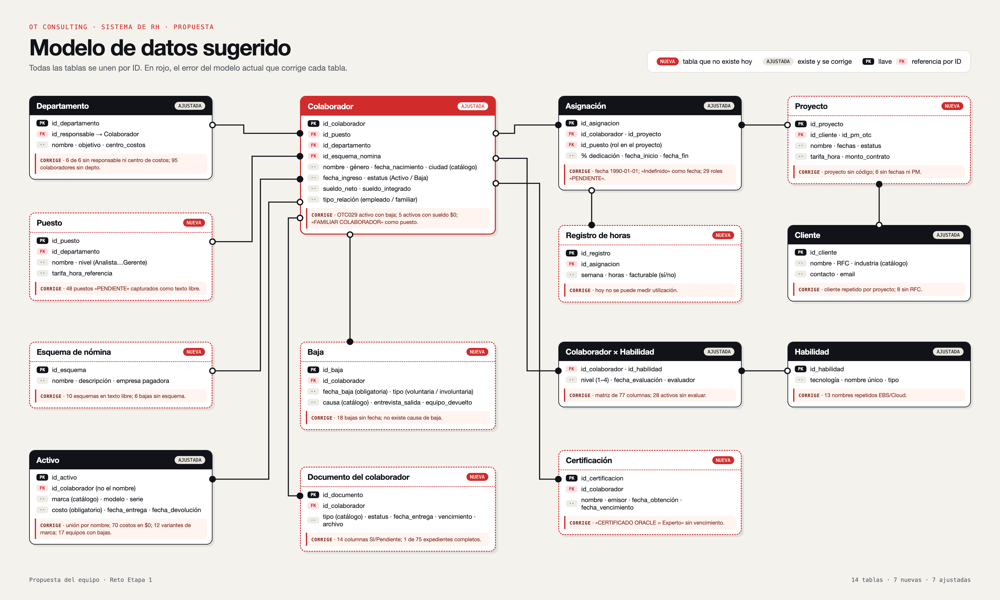

# Reto OT Consulting · Analítica de Recursos Humanos

<p align="center">
  
</p>

Proyecto académico con el socio formador **OT Consulting**, una consultora mexicana que implementa Oracle EBS, Oracle Cloud y NetSuite. Trabajamos sobre el área de **Recursos Humanos**: como la empresa vende horas y conocimiento de su gente, los datos de RH son clave para el negocio.

## El problema

RH guarda la información de sus colaboradores en un sistema propio, pero los datos no permiten responder tres preguntas básicas:

| Pregunta del negocio | Por qué hoy no se puede contestar |
|---|---|
| ¿Por qué se va la gente y cuánto nos cuesta? | No se registra la causa de baja y muchas bajas no tienen fecha |
| ¿Qué parte de la plantilla genera ingreso? | Gran parte de los activos no tiene asignación capturada y no hay horas ni tarifas |
| ¿Tenemos el talento para los proyectos que vienen? | La matriz de habilidades está incompleta y las certificaciones no vencen |

La causa de fondo es el diseño de los datos: texto libre en lugar de catálogos, tablas unidas por nombre en vez de por ID, valores de relleno como `PENDIENTE` o `1990-01-01`, y campos que el negocio necesita pero que nunca se capturan.

<p align="center">
  
</p>

## Nuestro enfoque

1. **Explorar** las 7 fuentes del sistema (colaboradores, asignaciones, clientes, activos, departamentos, habilidades y matriz de habilidades) para encontrar errores e inconsistencias.
2. **Proponer un modelo** de datos unido por ID, con 20 reglas de negocio y los indicadores que RH necesita.
3. **Acondicionar** los datos con un pipeline que corrige sin borrar ni inventar registros.
4. **Mostrar** los resultados en un tablero y en un sistema de agentes que ayuda a RH a operar día a día.

<p align="center">
  
  
</p>

## Componentes del sistema

### Pipeline de acondicionamiento · [`src/`](src)

[`acondicionamiento_rh.py`](src/acondicionamiento_rh.py) aplica 14 métodos de corrección (M1–M14): normaliza textos, homologa catálogos, convierte los valores de relleno en nulos con bandera, reconstruye las llaves y pasa la matriz de habilidades a formato largo. Cada cambio queda registrado en `log_correcciones`, y si alguna validación no da cero, el proceso se detiene.

El resultado es una base SQLite con las tablas limpias. Sobre ella, [`indicadores.sql`](src/indicadores.sql) define los indicadores como vistas (rotación, banca, costo, habilidades, expediente y calidad de datos), y [`extension.sql`](src/extension.sql) deja listas las tablas para lo que hoy no se captura: causa de baja, horas, tarifas y certificaciones.

### Tablero de RH · [`tablero/`](tablero)

Aplicación en React + Tailwind que presenta los indicadores por tema. Las cifras siempre indican sobre cuántos registros se calcularon, y lo que falta se muestra rayado en vez de rellenarse.

<p align="center">
  
</p>

### Agentes de RH · [`agentes/`](agentes)

Aplicación en Firebase con **7 agentes de IA** (Gemini en Vertex AI) que trabajan sobre los datos ya limpios: Asistente RH, Analista de rotación, Staffing, Reclutador, Nómina y asistencia, Clima y cultura, y Auditor de datos. Entre todos comparten 26 herramientas.

- Cada mañana una rutina revisa las reglas de negocio y genera una bandeja de tareas para RH.
- Los agentes **no modifican datos por su cuenta**: proponen cambios y una persona de RH los aprueba.
- Incluye asistencia, vacaciones, prenómina de control, encuestas de clima, lector de CVs, 11 procedimientos (SOPs) y memoria de contexto.
- Las mismas herramientas se pueden usar desde Claude Code mediante el servidor MCP configurado en [`.mcp.json`](.mcp.json).

Instrucciones de instalación y despliegue en [`agentes/README.md`](agentes/README.md).

## Estructura del repositorio

```
RetoOTConsulting/
├── datos/        dataset base del reto y archivos procesados
├── docs/         entregables del reto, etapas 1 a 5
├── notebooks/    análisis exploratorio y limpieza en Python
├── src/          pipeline de acondicionamiento e indicadores SQL
├── tablero/      tablero de RH (React + Tailwind)
├── agentes/      sistema de agentes en Firebase
├── img/          imágenes del proyecto
├── CLAUDE.md     contexto del reto: reglas, métodos y fórmulas
└── .mcp.json     servidor MCP de los agentes
```

## Entregables

| Etapa | Documento |
|:-:|---|
| 1 | [Planeación y justificación](docs/RETO%20ETAPA%201%20Planeaci%C3%B3n%20y%20justificaci%C3%B3n.pdf) |
| 2 | [Análisis y exploración de datos](docs/RETO%20ETAPA%202%20An%C3%A1lisis%20y%20exploraci%C3%B3n%20de%20datos.pdf) |
| 3 | [Tratamiento y acondicionamiento de datos](docs/RETO%20ETAPA%203%20Tratamiento%20y%20acondicionamiento%20de%20datos.pdf) |
| 4 | [Diseño del Modelo Dimensional Lógico](docs/RETO%20ETAPA%204%20Dise%C3%B1o%20del%20Modelo%20Dimensional%20L%C3%B3gico.pdf) |
| 5 | [Construcción del Modelo Dimensional Físico y Mecanismos de Análisis (1a. parte)](docs/RETO%20ETAPA%205%20Construcci%C3%B3n%20del%20Modelo%20dimensional%20F%C3%ADsico%20y%20Mecanismos%20de%20An%C3%A1lisis%20%281a.%20Parte%29.pdf) |

## Cómo usarlo

**Notebooks.** Abre `jupyter notebook notebooks/`. Los dos cuadernos leen `datos/DATASET_BASE_OTC.xlsx`.

**Pipeline y tablero.** El pipeline lee los 7 exports del sistema por separado (`Catalogo_Colaboradores.xlsx`, `Asignaciones_Colaboradores.xlsx`, `Catalogo_Clientes.xlsx`, `Catalogo_Activos.xlsx`, `Catalogo_Departamentos.xlsx`, `Catalogo_Habilidades.xlsx` y `Matriz_Habilidades.xlsx`) desde la carpeta `datos/`:

```bash
python -m venv .venv && source .venv/bin/activate
pip install -r requirements.txt

python src/acondicionamiento_rh.py --corte 2026-11-20   # crea salida/otc_rh.db
python src/exportar_tablero.py                          # genera los datos del tablero

cd tablero && npm install && npm run dev
```

**Agentes.** Se necesita acceso al proyecto de Firebase `otc-rh-agentes`; los pasos están en [`agentes/README.md`](agentes/README.md).

## Equipo

Emilio Ogaz Galván · Franco Varela Villegas · Angelica Velez Cantu · Melissa Anahid Esparza López · José Fernando Munguía Zertuche

<sub>El pipeline, el tablero y los agentes provienen del repo de Franco Varela: <a href="https://github.com/Francovarelav/otconsultingdocumentacion">Francovarelav/otconsultingdocumentacion</a>.</sub>
