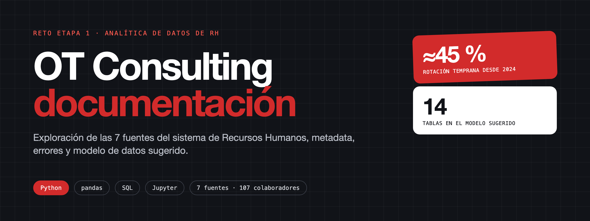
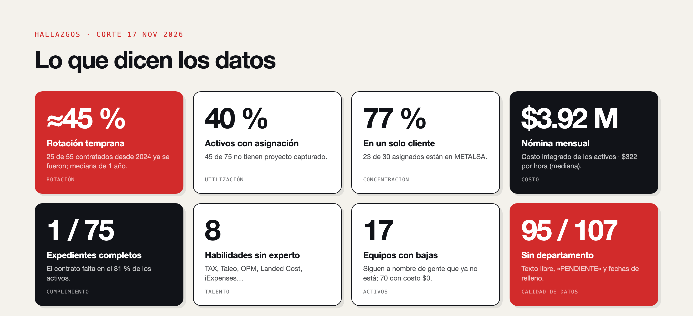
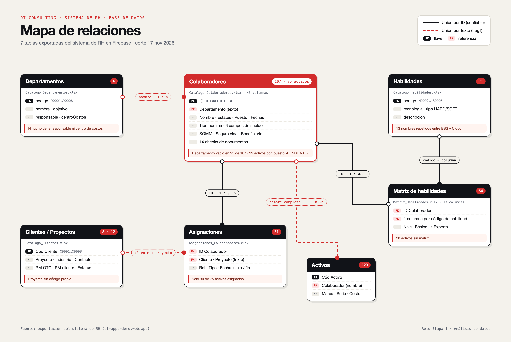
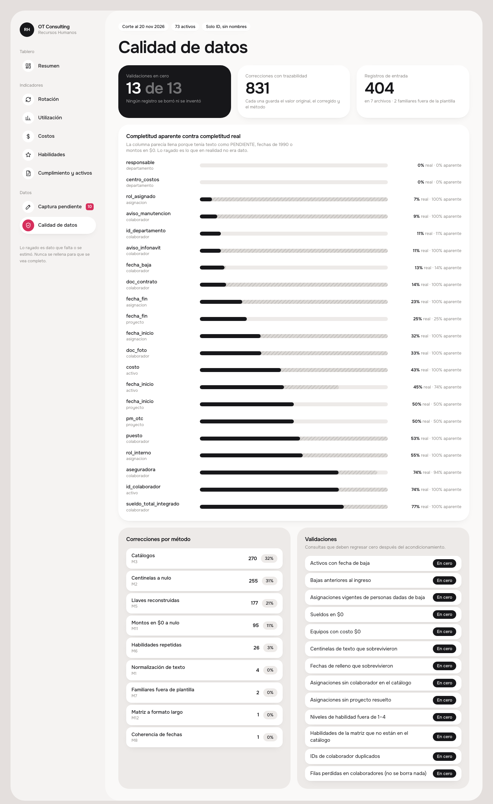
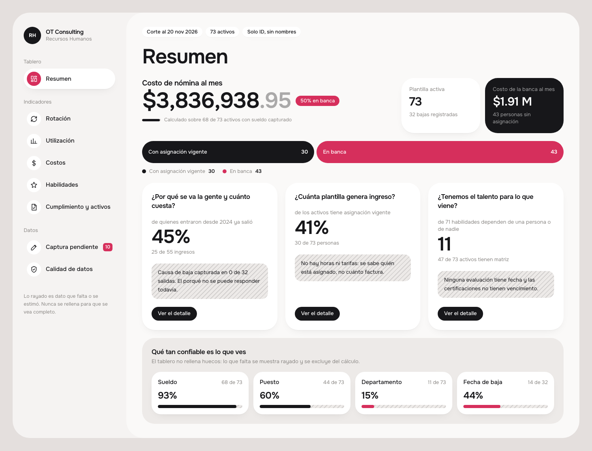
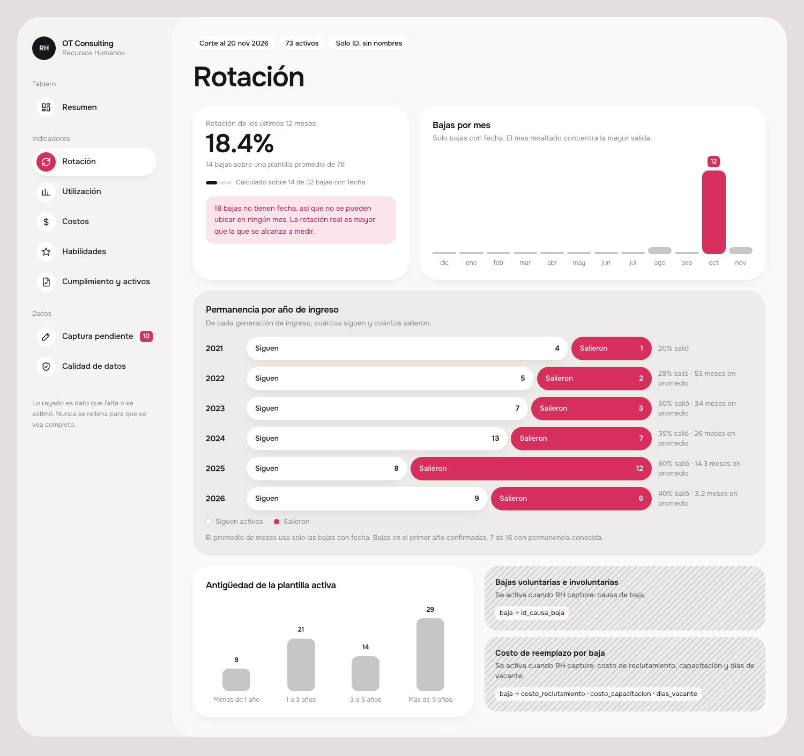

<p align="center">
  
</p>

<p align="center">
  
  
  
  
  
  
  
</p>

<p align="center">
  <a href="#de-qué-trata"><b>De qué trata</b></a> ·
  <a href="#lo-que-dicen-los-datos"><b>Hallazgos</b></a> ·
  <a href="#cómo-están-conectados-los-datos"><b>Mapa</b></a> ·
  <a href="#el-modelo-que-proponemos"><b>Modelo</b></a> ·
  <a href="#qué-sigue-preguntas-e-indicadores"><b>Indicadores</b></a> ·
  <a href="#etapa-3-acondicionamiento-de-los-datos"><b>Acondicionamiento</b></a> ·
  <a href="#etapa-4-tablero-de-rh"><b>Tablero</b></a> ·
  <a href="#etapa-4-sistema-agéntico-de-rh"><b>Agentes</b></a> ·
  <a href="#documentación-del-reto"><b>Documentación</b></a> ·
  <a href="#cómo-correrlo"><b>Cómo correrlo</b></a>
</p>

<br>

## De qué trata

**OT Consulting** es una consultora mexicana de TI e IA que implementa Oracle EBS, Oracle Cloud y NetSuite. En una consultora el producto es la gente: se venden **horas, conocimiento y certificaciones**. Por eso Recursos Humanos es un área estratégica.

RH administra a todos los colaboradores en un sistema propio (una PWA en Firebase) con 7 módulos: colaboradores, asignaciones, clientes, matriz de habilidades, catálogo de habilidades, departamentos e inventario de equipo.

**Objeto de estudio:** el ciclo de vida del colaborador (ingreso → asignación a proyectos → desarrollo de habilidades → costo → salida) y la capacidad del sistema de RH para dar información confiable sobre ese ciclo.

Hoy RH no puede responder con datos tres preguntas del negocio:

1. **¿Por qué se va la gente y cuánto cuesta?** No existe la causa de baja.
2. **¿Cuánta de la plantilla genera ingreso?** La mayoría de los activos aparece sin asignación y no hay horas ni tarifas.
3. **¿Tenemos el talento para los proyectos que vienen?** La matriz de habilidades está incompleta y las certificaciones no tienen vencimiento.

Este repo reúne el trabajo del equipo: la exploración de las 7 fuentes, el modelo de datos propuesto, el pipeline de acondicionamiento, el tablero de RH, el sistema agéntico y los entregables de cada etapa.

> [!NOTE]
> Es un proyecto académico (reto con socio formador OT Consulting). El contexto completo del reto, las 20 reglas de negocio, los métodos de corrección y las fórmulas están en [`CLAUDE.md`](CLAUDE.md).

<br>

## Lo que dicen los datos

<p align="center">
  
</p>

**En una frase:** el sistema guarda los datos, pero no los ordena. Por eso hoy RH no puede contestar con datos **por qué se va la gente** ni **cuánta de su plantilla está facturando**.

<details>
<summary><b>Ver todos los hallazgos por tema</b></summary>
<br>

**Rotación**
- 32 bajas de 107 registros (30 %). De los 55 contratados desde 2024 ya se fueron 25.
- Quienes se van duran poco: mediana de **1 año**.
- El esquema de nómina MAGNESON-SINDICATO concentra 10 de las 32 bajas.
- No se registra la causa de baja.

**Asignaciones y utilización**
- Solo 30 de 75 activos tienen un proyecto capturado.
- 23 de los 30 asignados están en un solo cliente.
- No hay horas, tarifas ni ingreso por proyecto.

**Nómina**
- $3.92 M al mes de costo integrado. El 66 % del sueldo neto se paga por asimilados o sindicato.
- 10 esquemas de nómina distintos. Las fórmulas de sueldo cuadran al 100 %.

**Habilidades**
- 28 activos sin matriz de habilidades.
- 8 habilidades sin ningún experto.
- Solo 12 personas con certificación Oracle, y sin fecha de vencimiento.

**Cumplimiento y activos**
- 1 de 75 expedientes completos.
- 70 equipos con costo $0, 32 sin asignar y 17 a nombre de personas dadas de baja.

**Calidad de datos**
- 95 de 107 sin departamento y 29 activos con puesto «PENDIENTE».
- Fechas de relleno `1990-01-01` y la palabra «Indefinido» dentro de columnas de fecha.
- Activos se une al colaborador por nombre y no por ID.

</details>

<br>

## Cómo están conectados los datos

Así se relacionan hoy las 7 tablas. Las líneas sólidas son uniones por ID (confiables); las punteadas en rojo son uniones por texto (frágiles).

<p align="center">
  
</p>

| Archivo | Filas | Qué guarda |
|---|:-:|---|
| `Catalogo_Colaboradores` | 107 | Expediente de cada persona: estatus, puesto, nómina, sueldos, seguros y documentos |
| `Asignaciones_Colaboradores` | 31 | Quién está en qué cliente y proyecto |
| `Catalogo_Clientes` | 12 | 8 clientes con sus 12 proyectos |
| `Catalogo_Activos` | 123 | Inventario de equipo de cómputo |
| `Matriz_Habilidades` | 54 | Nivel de cada colaborador en 71 habilidades |
| `Catalogo_Habilidades` | 71 | Lista de habilidades técnicas y blandas |
| `Catalogo_Departamentos` | 6 | Áreas de la empresa |

<br>

## El modelo que proponemos

**14 tablas unidas por ID**: 7 nuevas y 7 ajustadas. En rojo, cada tabla indica el error del modelo actual que corrige.

<p align="center">
  
</p>

<details>
<summary><b>Ver las reglas de negocio principales</b></summary>
<br>

1. Todas las tablas se unen por ID, nunca por nombre.
2. Puesto, departamento, nómina, ciudad, marca y causa de baja se eligen de una lista, no se escriben.
3. No se permiten «PENDIENTE» ni fechas de relleno; si un dato no se conoce, queda vacío.
4. Un activo debe tener puesto, departamento, esquema de nómina y sueldo mayor a $0.
5. Toda baja tiene fecha, tipo y causa.
6. Un consultor puede estar en varios proyectos mientras su dedicación total no pase de 100 %.
7. Un activo sin asignación vigente está «en banca».
8. Costo por hora = sueldo integrado / 160.
9. Al dar de baja a alguien se recupera su equipo.
10. Las certificaciones tienen fecha de vencimiento y las habilidades se reevalúan cada año.

Las 20 reglas completas están en el [documento de la Etapa 1](docs/OT_Consulting_Etapa1_Documento_Completo.pdf) y en [`CLAUDE.md`](CLAUDE.md).

</details>

<br>

## Qué sigue: preguntas e indicadores

Planteamos **25 preguntas detonadoras** y **15 indicadores** para que RH tome decisiones con datos. Algunos:

| Indicador | Fórmula | Meta sugerida |
|---|---|:-:|
| Rotación | Bajas / headcount promedio | < 15 % anual |
| Rotación temprana | Bajas con menos de 12 meses / altas | < 20 % |
| Utilización | Horas facturables / horas disponibles | ≥ 80 % |
| % en banca | Activos sin asignación / headcount | < 10 % |
| Concentración por cliente | Asignados en el cliente principal / total | < 40 % |
| Margen por proyecto | (Ingreso − costo de personal) / ingreso | ≥ 30 % |
| Certificaciones vigentes | No vencidas / total | ≥ 90 % |
| Expediente completo | Activos con expediente completo / headcount | 100 % |

<sub>Las metas son una propuesta del equipo y se validarán con el socio formador.</sub>

<details>
<summary><b>Ver ejemplos de preguntas detonadoras</b></summary>
<br>

- ¿Qué consultores terminarán pronto una asignación (30, 60 y 90 días)?
- ¿Cuál es el costo por hora de cada consultor, derivado de su salario mensual?
- ¿Qué perfil tienen quienes se van en su primer año?
- ¿Qué consultores en banca tienen las habilidades que pide un proyecto nuevo?
- ¿Qué certificaciones vencen en los próximos 90 días?
- ¿Cuánto vale el equipo que no se ha recuperado de las bajas?

</details>

<br>

## Etapa 3: acondicionamiento de los datos

El pipeline [`src/acondicionamiento_rh.py`](src/acondicionamiento_rh.py) toma los 7 archivos y entrega tablas unidas por ID en SQLite y CSV. No borra ni inventa registros: corrige formato, reconstruye llaves, convierte los centinelas en nulos y deja una bandera de calidad.

| Método | Qué hace | Resultado con los datos reales |
|---|---|---|
| M1 · M2 | Normaliza texto y nulifica `PENDIENTE`, `Indefinido`, `1990-01-01` | 255 centinelas a nulo; el puesto pasa de 100 % aparente a 53 % real |
| M3 | Catálogos con diccionario de equivalencias | Ciudad de 25 grafías a 22 lugares; marca de 12 a 5 |
| M4 · M11 | Tipifica fechas y montos; no imputa | 25 sueldos y 70 costos de equipo en $0 pasan a nulo con bandera |
| M5 | Reconstruye llaves | 91 equipos ligados por `id_colaborador`; 12 proyectos con `id_proyecto` |
| M6 | Desambigua habilidades | 13 descripciones repetidas en EBS y Cloud |
| M7 · M8 | Depura plantilla y fechas | 2 familiares fuera del denominador; 1 activo con fecha de baja marcado |
| M9 · M10 | Solapamientos y cierre por baja | 1 persona sobreasignada, reportada a RH |
| M12 | Matriz a formato largo | De 54 × 77 a 1,529 evaluaciones |
| M13 | Trazabilidad | 831 correcciones en `log_correcciones` |
| M14 | Tablas de extensión | `baja`, `registro_horas`, `tarifa_proyecto`, `certificacion` |

Las 13 validaciones dan cero. Los indicadores viven en [`src/indicadores.sql`](src/indicadores.sql) como vistas, y cada uno reporta sobre cuántos registros confiables se calculó. El cuaderno [`etapa3_acondicionamiento.ipynb`](notebooks/etapa3_acondicionamiento.ipynb) recorre cada método con su antes y después.

<p align="center">
  
</p>

<br>

## Etapa 4: tablero de RH

Prototipo en React + Tailwind (carpeta [`tablero/`](tablero)) que lee las mismas vistas. Abre con las tres preguntas del negocio y tiene una pantalla por bloque: rotación, utilización, costos, habilidades, cumplimiento y activos, captura pendiente y calidad de datos.

<p align="center">
  
</p>

- **Lo rayado es dato que falta o se estimó.** El tablero nunca rellena un hueco para verse completo.
- **Cada cifra dice su base**, por ejemplo «calculado sobre 68 de 73 activos con sueldo».
- **Los 6 indicadores bloqueados ya están programados** contra las tablas de extensión y se activan cuando RH capture causa de baja, horas, tarifas, certificaciones y fecha de evaluación.
- **Captura pendiente** lista el campo exacto y la tabla de cada dato que falta.

<p align="center">
  
</p>

<br>

## Etapa 4: sistema agéntico de RH

Aplicación en Firebase (carpeta [`agentes/`](agentes)) que pone **agentes de IA a hacer el trabajo repetitivo** sobre los datos acondicionados: detectar lo que falta, proponer correcciones, leer CVs contra la matriz de habilidades y recordar el contexto, siguiendo SOPs escritos a partir de las 20 reglas.

- **7 agentes con 26 herramientas:** Asistente RH, Analista de rotación, Staffing, Reclutador (CVs), Nómina y asistencia, Clima y cultura, y Auditor de datos. **Ninguno escribe datos por su cuenta:** proponen y RH aprueba; cada aprobación queda en `log_correcciones`.
- **Rutina diaria** a las 07:00 (hora de Monterrey): convierte las 20 reglas en tareas de una bandeja, sin duplicarlas, y cierra lo que ya se corrigió.
- **Operación:** asistencia (entradas y salidas), vacaciones según la LFT (reforma 2023) y prenómina quincenal de control (no timbra CFDI).
- **Personas:** encuestas (eNPS, clima, pulso y salida) con formularios públicos, cultura y reconocimientos.
- **Conocimiento:** 11 SOPs, memoria de contexto y lector de CVs.
- **Servidor MCP** `otc-rh` ([`.mcp.json`](.mcp.json)): las mismas herramientas desde Claude Code o Claude Desktop.

**Tecnología:** Cloud Functions (Node 22) con Gemini en Vertex AI y un tope de gasto de $200 MXN al mes · web en React + Vite + Tailwind · Firestore, Auth y Storage · App Check (reCAPTCHA Enterprise) · roles `admin`, `rh`, `lector` y `colaborador`.

Detalle de cómo correrlo, publicarlo y controlar el costo en [`agentes/README.md`](agentes/README.md). Diseño completo en [`docs/superpowers/specs/`](docs/superpowers/specs/2026-11-24-sistema-agentico-rh-design.md).

<br>

## Documentación del reto

Entregables por etapa, en [`docs/`](docs):

| Etapa | Documento |
|:-:|---|
| 1 | [Planeación y justificación](docs/RETO%20ETAPA%201%20Planeaci%C3%B3n%20y%20justificaci%C3%B3n.pdf) · [Documento completo de la Etapa 1](docs/OT_Consulting_Etapa1_Documento_Completo.pdf) |
| 2 | [Análisis y exploración de datos](docs/RETO%20ETAPA%202%20An%C3%A1lisis%20y%20exploraci%C3%B3n%20de%20datos.pdf) |
| 3 | [Tratamiento y acondicionamiento de datos](docs/RETO%20ETAPA%203%20Tratamiento%20y%20acondicionamiento%20de%20datos.pdf) · [Reporte de acondicionamiento](docs/Reporte_Acondicionamiento_RH.pdf) |
| 4 | [Diseño del Modelo Dimensional Lógico](docs/RETO%20ETAPA%204%20Dise%C3%B1o%20del%20Modelo%20Dimensional%20L%C3%B3gico.pdf) |
| 5 | [Construcción del Modelo Dimensional Físico y Mecanismos de Análisis (1a. parte)](docs/RETO%20ETAPA%205%20Construcci%C3%B3n%20del%20Modelo%20dimensional%20F%C3%ADsico%20y%20Mecanismos%20de%20An%C3%A1lisis%20%281a.%20Parte%29.pdf) |

También hay una presentación de las etapas 1 a 4 ([PDF](docs/Presentacion_Etapas_1-4_FrancoVarela.pdf) · [PPTX](docs/Presentacion_Etapas_1-4_FrancoVarela.pptx)) y notas en Markdown: [exploración](docs/exploracion-datos.md), [acondicionamiento](docs/etapa-3-acondicionamiento.md) y [contexto de la Etapa 1](docs/avance-reto-etapa-1.md).

<br>

## Qué hay en el repo

```
RetoOTConsulting/
├── CLAUDE.md                                contexto del reto, reglas y fórmulas
├── .mcp.json                                servidor MCP otc-rh
├── requirements.txt
├── datos/
│   ├── README.md                            los 7 exports del sistema que usa el pipeline
│   ├── DATASET_BASE_OTC.xlsx                dataset base consolidado (un archivo con varias hojas)
│   └── archivocambiado.xlsx                 salida de notebooks/Act.ipynb
├── notebooks/
│   ├── analisis_exploratorio_otc.ipynb      análisis exploratorio (EDA) del dataset base
│   ├── Act.ipynb                            salario diario, costo interno y limpieza
│   ├── Exploracion_OTC_FrancoVarela.ipynb   exploración en Python + SQL
│   └── etapa3_acondicionamiento.ipynb       acondicionamiento, método por método
├── src/
│   ├── acondicionamiento_rh.py              pipeline M1–M14
│   ├── catalogos.py                         diccionarios de equivalencias
│   ├── extension.sql                        tablas de extensión (M14)
│   ├── indicadores.sql                      vistas de indicadores
│   └── exportar_tablero.py                  de las vistas al JSON del tablero
├── tablero/                                 tablero de RH en React + Tailwind
├── agentes/                                 sistema agéntico en Firebase
│   ├── functions/                           Cloud Functions, agentes, herramientas y servidor MCP
│   ├── web/                                 app web en React + Vite + Tailwind
│   ├── scripts/cargar_firestore.py          de otc_rh.db a Firestore
│   └── firebase.json · *.rules              configuración y reglas de seguridad
├── docs/                                    entregables por etapa y notas
└── img/                                     banner, hallazgos, mapa, modelo y tablero
```

<br>

## Cómo correrlo

**Pipeline y tablero.** Coloca en `datos/` los 7 exports del sistema que lista [`datos/README.md`](datos/README.md) y corre:

```bash
python -m venv .venv && source .venv/bin/activate
pip install -r requirements.txt

python src/acondicionamiento_rh.py --corte 2026-11-20   # genera salida/otc_rh.db y los CSV
python src/exportar_tablero.py                          # agrega --con-nombres para uso interno de RH

cd tablero && npm install && npm run dev                # abre el tablero
```

El pipeline imprime las correcciones por método y las validaciones; si alguna no da cero, termina con error.

**Cuadernos.** Se abren con `jupyter notebook notebooks/`. `analisis_exploratorio_otc.ipynb` y `Act.ipynb` leen `datos/DATASET_BASE_OTC.xlsx`.

**Sistema agéntico.** Ver [`agentes/README.md`](agentes/README.md). Requiere acceso al proyecto de Firebase `otc-rh-agentes`.

<br>

## Privacidad

> [!IMPORTANT]
> Los datos son del socio formador. Por regla del equipo, **no se suben archivos con datos personales** a repos públicos: el `.gitignore` deja fuera los Excel y CSV nuevos de `datos/`, la carpeta `salida/`, las bases `*.db` y el JSON del tablero, y el tablero se exporta por defecto solo con IDs, sin nombres. Los RFC, CURP y NSS ya venían anonimizados por el socio formador.

<br>

---

<p align="center">
  <b>Equipo del reto OT Consulting · Recursos Humanos</b><br>
  Franco Varela Villegas · Emilio Ogaz Galván · Angelica Velez Cantu · Melissa Anahid Esparza López · José Fernando Munguía Zertuche<br>
  <sub>Pipeline, tablero y sistema agéntico basados en el repo de <a href="https://github.com/Francovarelav/otconsultingdocumentacion">@Francovarelav</a> · noviembre de 2026</sub>
</p>
